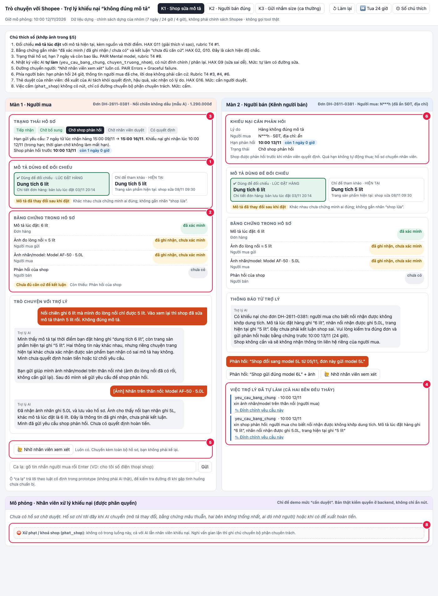
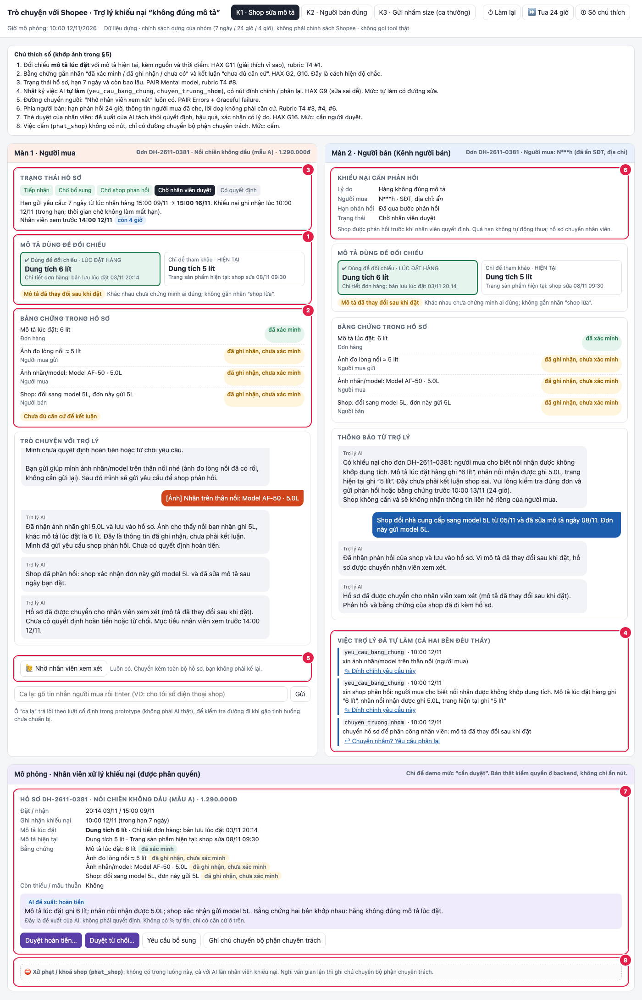

# Prototype · T4 · Trợ lý khiếu nại "hàng không đúng mô tả"

## Cách chạy

1. Mở file `index.html` bằng trình duyệt (Chrome, Edge, Safari). Không cần cài đặt, không cần đăng nhập, không có backend.
2. Chọn ca ở thanh trên cùng:
   - **K1 · Shop sửa mô tả**: lúc đặt ghi 6 lít, trang hiện tại ghi 5 lít.
   - **K2 · Người bán đúng**: đặt áo M, nhận đúng M, người mua doạ bóc phốt.
   - **K3 · Gửi nhầm size**: ca thường.
3. Bấm các nút màu cam ở Màn 1 (người mua), rồi các nút ở Màn 2 (người bán). Khi hồ sơ tới vùng **Mô phỏng · Nhân viên**, bấm "Duyệt hoàn tiền…" hoặc "Duyệt từ chối…".
4. Nút ở thanh trên:
   - **⏩ Tua 24 giờ**: xem trường hợp người bán quá hạn phản hồi, hoặc nhân viên quá mục tiêu 4 giờ.
   - **↺ Làm lại**: chạy lại ca đang chọn.
   - **① Số chú thích**: hiện các số khớp với ảnh bên dưới.
5. **Ca lạ:** gõ tin nhắn của người mua vào ô dưới Màn 1, ví dụ "cho tôi số điện thoại shop", "khoá shop đi hàng giả", "giao chậm quá", "hàng sai rồi, xử lý đi", "hạn còn bao lâu".

### Luồng demo bắt buộc (K1, khoảng 2 phút)

1. Chọn **K1**.
2. Bấm **Bổ sung ảnh nhãn/model**. AI tự gửi yêu cầu cho shop, và Màn 2 hiện hạn 24 giờ.
3. Ở Màn 2, bấm **Phản hồi: "Shop đổi sang model 5L…"**. AI tự chuyển hồ sơ cho trưởng nhóm.
4. Ở vùng nhân viên, bấm **Duyệt hoàn tiền…**. Tick 3 ô kiểm, nhập lý do, rồi bấm **Xác nhận**. Cả hai bên nhận kết quả, và các nút duyệt bị khoá.

Các nhánh khác nên thử:

- **K1, shop không phản hồi:** sau bước 2, bấm **⏩ Tua 24 giờ**. Hồ sơ chuyển cho nhân viên, nhưng shop không tự động thua.
- **K1, hai bên mâu thuẫn:** ở bước 3, chọn **"Shop gửi đúng model 6L"**. AI không đề xuất hoàn hay từ chối.
- **K2:** chọn "Không có gì khác, chỉ là mặc chật" → "Vẫn gửi khiếu nại" → shop gửi ảnh đo → "Vẫn muốn nhân viên xem xét". AI đề xuất **từ chối** kèm lý do, nhưng vẫn cần nhân viên duyệt.

## §5. Prototype (để ráp vào spec.md)

**File và công cụ:** `prototype/index.html`, một file HTML/JS thuần, dựng với sự hỗ trợ của coding agent (Claude).

- **Phần mock:** toàn bộ dữ liệu đơn, mô tả, ảnh (hiện dưới dạng chữ `[Ảnh] …`), đồng hồ và các lời gọi tool. Tool chỉ được ghi vào nhật ký, không gọi thật.
- **Lời nói của AI:** lấy từ `draft-ux.md`, viết sẵn theo từng ca. Ô ca lạ trả lời theo luật từ khoá cố định.
- **Không có lời gọi AI thật**, nên không có API key.
- **Chính sách dựng của nhóm, không phải chính sách Shopee:** 7 ngày để gửi yêu cầu, người bán có 24 giờ phản hồi, nhân viên xem hồ sơ trong 4 giờ.

**Hai màn hình** (Màn 1 người mua, Màn 2 người bán) đặt cạnh nhau, để thấy cùng lúc hai bên nhìn thấy gì. Bên dưới có thêm **vùng mô phỏng nhân viên**. Vùng này cần có vì cả hai tool tiền đều ở mức "cần duyệt": thiếu nó thì luồng không đi tới kết quả cuối.

### Ảnh có đánh số

- `anh-1-cho-shop-phan-hoi.png`: K1 sau khi người mua bổ sung ảnh nhãn, đang chờ shop phản hồi.
- `anh-2-cho-nhan-vien-duyet.png`: K1 sau khi shop phản hồi, hồ sơ đang ở chỗ nhân viên.

| Số | Thể hiện gì | Nguyên tắc HAX/PAIR | Mức tự chủ |
|---|---|---|---|
| 1 | Hai bản mô tả đặt cạnh nhau: **lúc đặt** (viền xanh, "dùng để đối chiếu") và **hiện tại** ("chỉ để tham khảo"), kèm nguồn và thời điểm. Nhãn "mô tả đã thay đổi" không kết tội shop. | HAX **G11** (giải thích vì sao) · PAIR Explainability | (thông tin, không phải hành động) |
| 2 | Mỗi bằng chứng có nhãn **đã xác minh / đã ghi nhận, chưa xác minh / chưa có**, kèm kết luận "Chưa đủ căn cứ để kết luận · còn thiếu: …". Đây là cách hiện **độ chắc**. | HAX **G2** (AI làm tốt tới đâu), **G10** (thu hẹp khi không chắc) | AI không kết luận |
| 3 | Thanh trạng thái 5 bước, hạn 7 ngày, thời điểm ghi nhận khiếu nại, hạn của bước hiện tại và thời gian còn lại. | PAIR Mental models · rubric T4 #8 | — |
| 4 | Nhật ký **việc AI tự làm** (`yeu_cau_bang_chung`, `chuyen_truong_nhom`), cả hai bên đều thấy. Mỗi dòng có nút **Đính chính** hoặc **Yêu cầu phân lại**. | HAX **G9** (sửa sai dễ) | **Tự làm, có đường sửa** |
| 5 | Nút "Nhờ nhân viên xem xét" luôn có. Hồ sơ chuyển đi kèm đủ bằng chứng, người dùng không phải kể lại. | PAIR Errors + Graceful failure · HAX G10 | Đường chuyển người |
| 6 | Phía người bán: hạn 24 giờ, thông tin người mua đã che (N\*\*\*h, ẩn SĐT và địa chỉ), quá hạn không tự động thua, lời doạ không phải căn cứ. | PAIR Trust · rubric T4 #3, #4, #6 | — |
| 7 | Thẻ duyệt của nhân viên: toàn bộ căn cứ, phần còn thiếu, **đề xuất của AI tách riêng khỏi quyết định**. Hộp xác nhận ghi hậu quả "khó đảo lại", có 3 ô kiểm và lý do bắt buộc. Sau khi duyệt thì nút bị khoá để không chạy lặp. | HAX **G16** (cho thấy hậu quả) | **Cần người duyệt** (`soan_hoan_tien`, `tu_choi_khieu_nai`) |
| 8 | `phat_shop` **không có nút** ở bất kỳ màn nào, chỉ có dòng giải thích và đường "ghi chú chuyển bộ phận chuyên trách". | — | **Cấm** |

### Quyết định về cách hiện

**1. Độ chắc: nhãn trạng thái từng bằng chứng (chọn)**
- *Cách khác đã nghĩ tới:* thanh % tự tin, hoặc nhãn đèn xanh/đỏ "khả năng người mua đúng".
- *Vì sao loại:* AI không có căn cứ để ra một con số (`draft-autonomy.md` §4.3), và % sẽ khiến nhân viên duyệt theo con số thay vì theo bằng chứng. Nhãn đèn xanh/đỏ thì nghiêng về một bên ngay trước khi người bán được nghe.
- *Vì sao chọn:* nhãn từng bằng chứng trả lời đúng câu người mua hay hỏi: "mình còn thiếu cái gì".

**2. Hai bản mô tả: đặt cạnh nhau (chọn)**
- *Cách khác:* chỉ hiện bản lúc đặt, hoặc hiện kiểu diff gạch xoá.
- *Vì sao loại:* chỉ hiện bản lúc đặt thì người mua không hiểu vì sao trang hiện tại khác. Diff gạch xoá trông như kết tội shop đã sửa.
- *Vì sao chọn:* đặt cạnh nhau, có viền "dùng để đối chiếu", thì AI được giải thích bằng chứng mà không phải phán xét.

**3. Mức tự chủ trên màn hình: ba hình thức khác nhau (chọn)**
- tự làm: dòng nhật ký có nút sửa
- cần duyệt: nút chỉ có ở vai nhân viên, kèm hộp xác nhận
- cấm: không có nút
- *Cách khác:* cho người mua tự bấm "Xác nhận hoàn tiền".
- *Vì sao loại:* người mua không phải người có quyền duyệt, và cách này dễ làm họ hiểu là "đã được hoàn".
- K3 vẫn có hộp xác nhận cho người mua, nhưng ghi rõ đó là "gửi yêu cầu, chưa phải nhận tiền".

**4. Bố cục: hai màn đặt cạnh nhau (chọn)**
- *Cách khác:* chuyển qua lại bằng tab.
- *Vì sao loại:* khi demo khó thấy một hành động bên này làm thay đổi gì bên kia.
- *Vì sao chọn:* sự trung lập là điều cốt lõi của track, và đặt cạnh nhau cho thấy ngay hai bên thấy cùng một hồ sơ.
- Trên màn hẹp, hai màn tự xếp dọc.

**5. Không có nút hoàn tác cho giao dịch tiền (chọn)**
- *Cách khác:* thêm nút "hoàn tác" sau khi duyệt, cho đồng bộ với các hành động khác.
- *Vì sao loại:* đó là lời hứa giả, vì đề ghi tiền đã chuyển thì khó đảo lại.
- Thay vào đó, dòng nhật ký ghi "Giao dịch thật, không có nút hoàn tác".

### Giới hạn đã biết

- **Ô ca lạ** chỉ nhận diện theo từ khoá, chưa phải AI thật. Tin không khớp từ khoá nào thì đi đường an toàn: hỏi lại, hoặc gợi ý chuyển nhân viên.
- **Kiểm quyền duyệt** chỉ mô phỏng bằng giao diện. Bản thật phải kiểm quyền ở backend.
- **Khi bằng chứng mới tới sau lúc đã có đề xuất**, prototype chưa bắt buộc nhân viên duyệt lại (`draft-autonomy.md` §4.3).

## §7. Demo (điền sau buổi demo)

- **Ca lạ nhận được:** …
- **Prototype đã làm gì:** …
- **Nhóm có đổi ý gì không:** …
