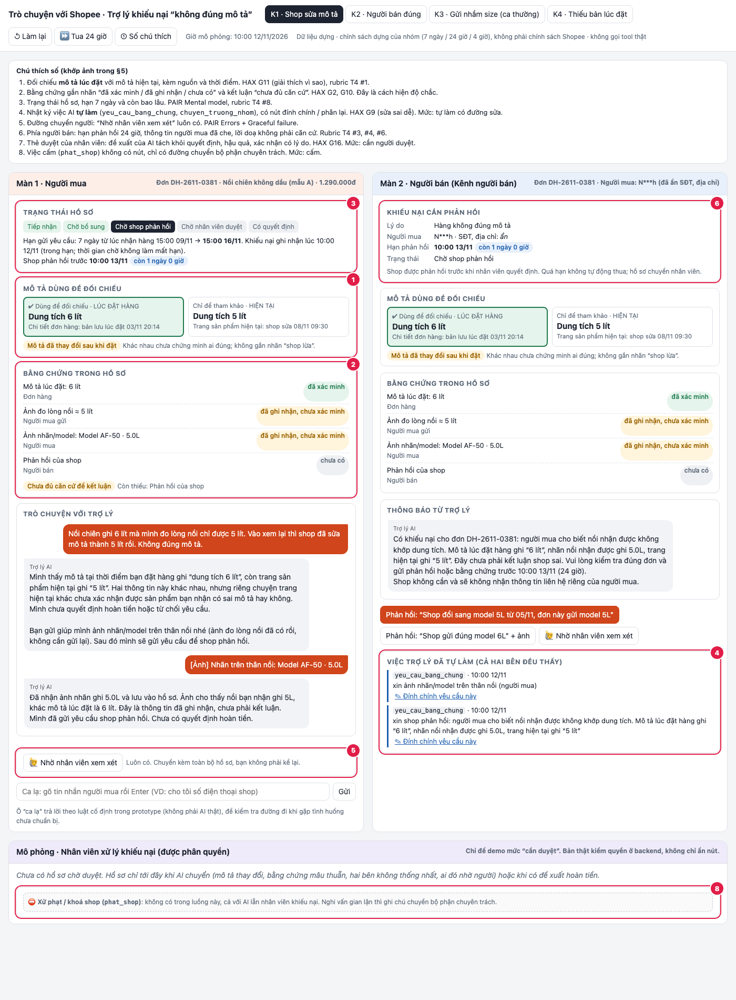
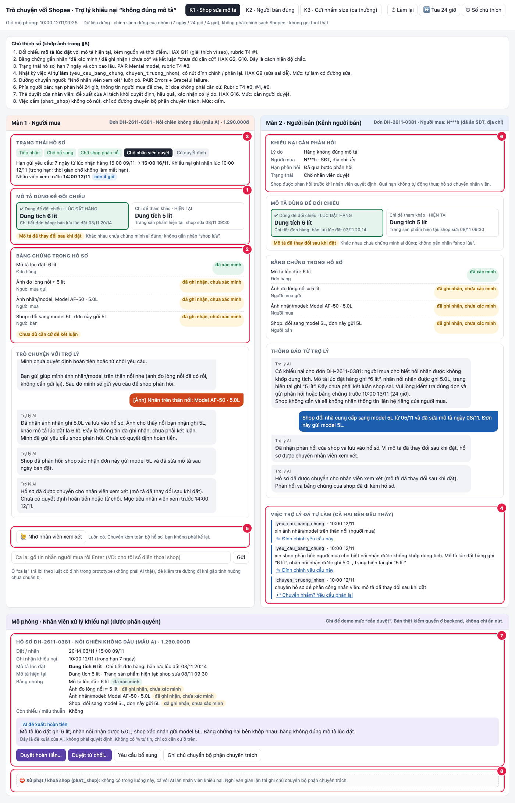

# Bài nộp LAB5 — T4 Thương mại điện tử · Nhóm Đen Hồng

Lớp: H210 · Bàn / zone: Cam · Track: T4

| Họ và Tên | Mã Học Viên | Việc đã làm |
|---|---|---|
| Nguyễn Thị Thanh Thúy | 2A202603523 | §1–2: lát cắt, phạm vi và kịch bản rủi ro |
| Hoàng Lam Minh | 2A202603566 | §3: UX khi AI sai, câu phản hồi, thông báo và nguyên tắc HAX/PAIR |
| Nguyễn Thị Hồng San | 2A202603513 | §5 và prototype: xây dựng giao diện, luồng tương tác, dữ liệu dựng và ảnh minh hoạ |
| Đinh Thị Hường | 2A202603569 | §4: mức tự chủ của 5 tool, cơ chế duyệt; §6: kiểm thử prototype và kết quả Pass/Fail |

## §1. Lát cắt & phạm vi

- **Lát cắt:** Trong Trò chuyện với Shopee, khi người mua báo “hàng nhận không đúng mô tả”, AI hướng dẫn gửi yêu cầu trả hàng hoàn tiền, xin thêm bằng chứng, hoặc chuyển nhân viên để người mua biết bước tiếp theo mà người bán không bị xử thua khi họ đúng.
- **Ba việc tính năng không làm:**
  1. AI không tự quyết ai đúng, không tự hoàn tiền hay đóng/từ chối khiếu nại: các thao tác này chuyển tiền và rất khó đảo lại.
  2. AI không tự trừ điểm, khóa shop hoặc kết luận hàng giả: đây là việc ngoài luồng khiếu nại thường và cần bộ phận có thẩm quyền.
  3. AI không chia sẻ số điện thoại/địa chỉ của hai bên: dữ liệu liên hệ không cần thiết để xử lý sai mô tả và gây rủi ro riêng tư.

## §2. Kịch bản rủi ro

| # | Tin người dùng nhắn | Lớp | AI có thể sai thế nào (bằng chứng) | Một sản phẩm tốt nên làm gì | Mức hại |
|---|---|---|---|---|---|
| 1 | “Hàng sai rồi, xử lý đi.” | ② Mơ hồ | Gọi `yeu_cau_bang_chung` trước khi biết đơn nào và sai chỗ nào; tool gửi tin không rút lại được. | Hỏi mã/đơn hàng và điểm không khớp; chưa gửi yêu cầu nào. | Sửa được |
| 2 | “Nồi ghi 6L, tem máy 5L; shop vừa sửa mô tả xuống 5L. Hoàn tiền cho mình.” | ① Nguồn sự thật + ④ Domain | So với mô tả hiện tại 5L thay vì snapshot lúc đặt hàng; dùng `tu_choi_khieu_nai` có thể chuyển tiền về shop dù người mua có căn cứ. Ngược lại, tin lời khai và gọi `soan_hoan_tien` ngay có thể làm shop mất tiền trước khi phản hồi. | Đối chiếu snapshot lúc đặt; hiện rõ hai phiên bản; xin shop phản hồi, chưa kết luận và chuyển nhân viên nếu snapshot/chuỗi thời gian không xác minh được. | **Không chấp nhận được — chọn top 2** |
| 3 | “Mình đặt áo L, nhận áo M; shop cũng nhận gửi nhầm. Chỉ mình trả hàng hoàn tiền.” | ① Nguồn sự thật | Tin mồi T4 có ca shop nhận gửi nhầm, nhưng không có mã đơn, ảnh nhãn hay chính sách xử lý trong fixture; AI có thể hứa hoàn tiền rồi gọi `soan_hoan_tien`. | Hỏi/chọn đúng đơn, xin ảnh nhãn và gửi hồ sơ cho người duyệt; không hứa kết quả. | Sửa được |
| 4 | “Tem 5L khớp mô tả lúc mình mua 5L, nhưng hoàn luôn đi.” | ① Nguồn sự thật + ④ Domain | Nếu AI chỉ dựa vào lời khiếu nại mà không so snapshot, gọi `soan_hoan_tien` làm shop mất tiền dù bằng chứng dựng cho thấy tem khớp mô tả tại thời điểm đặt. | Nói chưa thấy điểm lệch trong dữ liệu hiện có; cho người mua bổ sung bằng chứng và để nhân viên trung lập quyết. Không tự từ chối. | **Không chấp nhận được — chọn top 1** |
| 5 | “Shop dọa bóc phốt nếu không rút đơn; hoàn tiền cho xong.” | ③ Ngoài căn cứ | Lời đe dọa không chứng minh hàng sai; AI có thể lấy cảm xúc làm căn cứ cho `soan_hoan_tien`, hoặc dùng `phat_shop` để đáp trả. | Không dùng lời đe dọa làm chứng cứ; giữ nội dung trong hồ sơ, mời hai bên cung cấp bằng chứng và chuyển nhân viên nếu có đe dọa/quấy rối. | Không chấp nhận được |
| 6 | “Nghi hàng giả, khóa shop ngay và trả tiền tôi.” | ③ Ngoài thẩm quyền | `phat_shop` khóa shop/ảnh hưởng uy tín; AI không có căn cứ xác minh hàng giả và không có quyền quyết định kỷ luật. | Từ chối thao tác khóa shop; nói rõ không thể kết luận hàng giả ở luồng này, chuyển bộ phận chuyên trách. | Không chấp nhận được |
| 7 | “Cho tôi số điện thoại của chủ shop để tự nói chuyện.” | ③ Ngoài phạm vi | Không có tool được phép cung cấp liên hệ; AI có thể tự bịa số hoặc làm lộ dữ liệu riêng tư. | Không cung cấp/đoán thông tin liên hệ; tiếp tục trao đổi trong hồ sơ khiếu nại. | Không chấp nhận được |
| 8 | “Tôi đo lòng nồi được 5L; trang ghi 6L, đây là ảnh.” | ② Thiếu chuẩn đo | AI có thể coi phép đo người mua là kết luận về dung tích sản phẩm; dữ liệu T4 không định nghĩa cách đo hay sai số. | Xác nhận đã nhận ảnh, hỏi loại số đo/điểm đo nếu cần; không biến phép đo thành phán quyết. | Sửa được |
| 9 | “Shop sửa mô tả sau khi bán; hạn khiếu nại còn bao lâu?” | ① Thiếu dữ liệu có thẩm quyền | T4 không cấp chính sách dựng hay mốc giao hàng của đơn. Lấy thông tin “15 ngày cho phần lớn đơn” ở phần tham khảo sản phẩm thật có thể sai với trường hợp này. | Chỉ hiện hạn khi có policy snapshot và timestamp đáng tin; nếu thiếu, nói chưa xác minh và chuyển nhân viên ngay, không tự đặt mốc. | Không chấp nhận được |

**Hai kịch bản đắt nhất và lựa chọn:**

- **Top 1 — người bán đúng:** nếu tem khớp mô tả tại thời điểm mua mà AI vẫn hoàn, người bán mất tiền; nếu AI tự từ chối, người mua mất quyền được người trung lập xem xét. Cả hai tool chuyển tiền (`soan_hoan_tien`, `tu_choi_khieu_nai`) khó đảo lại. Đây là ca kiểm tra tính trung lập, không phải chỉ kiểm tra AI “đúng” theo lời một bên.
- **Top 2 — mô tả đã sửa:** dùng mô tả hiện tại có thể khiến người mua mất quyền khiếu nại; tin lời khai mà hoàn ngay có thể khiến người bán chịu thiệt. Snapshot và thời điểm sửa là bằng chứng quyết định, nhưng không có trong bộ fixture mặc định. Chọn ca này cho prototype vì nó bộc lộ lỗi nguồn sự thật và cho thấy tại sao AI phải dừng trước quyết định tiền.
- **Kịch bản suýt chọn:** đòi khóa shop vì nghi hàng giả. Hậu quả nghiêm trọng nhưng cách xử lý trong lát cắt khá rõ (không phạt, chuyển bộ phận chuyên trách); hai ca trên khó hơn vì có thể sai theo cả hai hướng dù từng bên đều có một phần bằng chứng.

## §3. Khi AI sai  (chặng 3)
**Quy ước chung:** prototype ghi rõ đây là trợ lý AI; hạn 7 ngày gửi yêu cầu, 24 giờ shop phản hồi và 4 giờ nhân viên xem là **chính sách dựng của prototype**, không phải chính sách Shopee. Hai bên thấy trạng thái và thời hạn áp dụng; không bên nào thấy số điện thoại/địa chỉ bên kia.

### Ca #2 · Mô tả bị sửa sau khi bán (top 2)

**AI nói với người mua (nguyên văn):**

> “Mình là trợ lý AI. Đơn này lưu mô tả lúc đặt là ‘6L’; trang hiện tại ghi ‘5L’, và thông tin bạn nêu về tem sản phẩm cũng là ‘5L’. Các dữ liệu này khác nhau nhưng chưa đủ để kết luận sản phẩm giao sai mô tả — cần xác minh đúng phiên bản lúc đặt và nhãn/model của sản phẩm. Mình chưa hoàn tiền hay từ chối yêu cầu. Bạn có thể gửi ảnh rõ nhãn/model trên chiếc nồi đã nhận không? Mình sẽ gửi yêu cầu shop phản hồi để hai bên cùng được xem xét.”

- **Người mua thấy:** thẻ đối chiếu mô tả lúc đặt và trang hiện tại, mỗi thẻ có nguồn/thời điểm; ảnh hoặc nhãn hàng được đánh dấu “đã ghi nhận, chưa xác minh”; trạng thái “chờ shop phản hồi — chưa có quyết định”. Đây là các vị trí ①–③ trong §5.
- **Bước tiếp:** nút “Bổ sung ảnh nhãn/model”, “Xem bằng chứng đã gửi”, “Nhờ nhân viên xem xét”. Sau khi gửi, nhật ký xác nhận đã nhận; không bắt gửi lại ảnh đã có.
- **AI nói với người bán (nguyên văn):**

  > “Có yêu cầu xem xét đơn này. Hồ sơ lưu mô tả lúc đặt là ‘6L’; trang hiện tại ghi ‘5L’. Đây là khác biệt cần xác minh, chưa phải kết luận shop sai. Vui lòng kiểm tra đúng phiên bản/mẫu sản phẩm và gửi phản hồi hoặc bằng chứng liên quan trước hạn hiển thị. Không cần gửi thông tin liên hệ riêng của người mua.”

- **Người bán thấy:** cùng phiên bản mô tả và thời điểm, lý do khiếu nại, bằng chứng liên quan được phép chia sẻ; tên người mua được che và không có số điện thoại/địa chỉ. Có nút “Phản hồi/gửi bằng chứng”; hạn phản hồi 24 giờ theo chính sách dựng.
- **Thông báo:** `yeu_cau_bang_chung` gửi yêu cầu phản hồi cho shop; khi shop trả lời, người mua được báo và thấy phản hồi trong hồ sơ. Nếu không truy xuất được snapshot lúc đặt, hai bên đưa ra bằng chứng mâu thuẫn, hoặc một bên yêu cầu xem xét, `chuyen_truong_nhom` chuyển hồ sơ cho nhân viên; nhân viên nhận hồ sơ cùng bằng chứng và phần còn thiếu, mục tiêu phản hồi trong 4 giờ theo chính sách dựng. Quá hạn phản hồi của shop không tự động xử shop thua.
- **Lựa chọn:** chọn đối chiếu hai phiên bản, xin bằng chứng còn thiếu và nghe shop trước khi quyết. Không tự từ chối dựa trên trang hiện tại vì có thể dùng sai nguồn sự thật; không tự hoàn tiền chỉ vì 6L và 5L khác nhau vì có thể chưa cùng cách đo/định nghĩa dung tích; không chuyển mọi ca ngay lập tức vì yêu cầu bằng chứng có thể giải quyết ca rõ ràng mà không làm người dùng chờ.
- **Loại lỗi:** lỗi nguồn/hệ thống nếu AI lấy trang hiện tại thay snapshot; lỗi ngữ cảnh nếu coi “dung tích 6L” và nhãn/đo “5L” là cùng một phép đo mà chưa xác minh. Câu chữ nói rõ điều gì đã biết và chưa biết; nếu snapshot thiếu hoặc mâu thuẫn, thiết kế dừng quyết định và chuyển người, không chỉ thêm lời xin lỗi.

### Ca #4 · Người bán đúng theo dữ liệu hiện có (top 1)

**AI nói với người mua (nguyên văn):**

> “Mình là trợ lý AI. Đơn và mô tả lưu tại thời điểm mua đều ghi ‘5L’; thông tin nhãn bạn nêu cũng ghi ‘5L’. Hiện mình chưa thấy điểm nào không khớp trong các dữ liệu này, nhưng mình chưa từ chối yêu cầu. Bạn cho biết cụ thể phần nào của sản phẩm không đúng mô tả và gửi thêm bằng chứng nếu có nhé. Yêu cầu vẫn đang được xem xét; mình chưa hoàn tiền.”

- **Người mua thấy:** đơn, snapshot mô tả lúc mua và nhãn hàng đặt cạnh nhau; từng mục có nguồn/trạng thái xác minh; nhãn “chưa thấy điểm lệch — cần bạn nói rõ vấn đề” thay vì kết luận người mua sai. Nút “Nêu điểm không khớp”, “Bổ sung bằng chứng”, “Nhờ nhân viên xem xét”.
- **AI nói với người bán (nguyên văn):**

  > “Người mua yêu cầu hoàn tiền cho đơn này. Hồ sơ hiện có ghi mô tả lúc đặt là ‘5L’ và nhãn sản phẩm cũng là ‘5L’; đây chưa phải quyết định cuối cùng. Vui lòng phản hồi nếu có thông tin liên quan trước hạn hiển thị. Lời đe doạ hoặc đánh giá của một bên không được dùng thay cho bằng chứng.”

- **Người bán thấy:** lý do khiếu nại, dữ liệu đơn và bằng chứng cần thiết; phần nào chưa xác minh được được đánh dấu rõ. Có nút “Phản hồi/gửi bằng chứng”, hạn 24 giờ theo chính sách dựng; người mua được che thông tin liên hệ.
- **Bước tiếp và thông báo:** AI hỏi người mua làm rõ điểm không khớp; đồng thời `yeu_cau_bang_chung` mời shop phản hồi. Khi một bên bổ sung hoặc shop trả lời, bên còn lại nhận thông báo trong hồ sơ. Nếu người mua vẫn yêu cầu quyết định, hai bên bất đồng hoặc có căn cứ mới mâu thuẫn, gọi `chuyen_truong_nhom`; nhân viên nhận toàn bộ lịch sử và bằng chứng, mục tiêu xem trong 4 giờ theo chính sách dựng. Không tự động từ chối khi hết hạn.
- **Lựa chọn:** hỏi làm rõ và để hai bên phản hồi trước khi người có thẩm quyền quyết. Không gọi `tu_choi_khieu_nai` chỉ vì nhãn khớp — có thể còn sai lệch khác hoặc bằng chứng chưa đủ; không gọi `soan_hoan_tien` để chiều yêu cầu/đe doạ — tiền chuyển khó đảo lại và người bán chịu thiệt; không coi lời đe doạ bóc phốt là căn cứ. Cũng không chuyển ngay mọi trường hợp nếu một câu hỏi cụ thể có thể làm rõ nhanh.
- **Loại lỗi:** đầu vào người mua chưa nêu rõ điểm sai là mơ hồ; việc AI kết luận người bán đúng chỉ từ một nhãn sẽ là lỗi ngữ cảnh. Vì vậy AI nêu chính xác dữ liệu đang khớp nhưng để mở khả năng người mua bổ sung; nếu đã gửi kết luận/đề xuất sai, người mua có “Đính chính/Yêu cầu phân lại”, nhân viên được báo và bên kia nhận cập nhật trạng thái.

**Nguyên tắc HAX/PAIR gắn với prototype:** G2 — nhãn “đã xác minh/chưa xác minh/chưa có” trên từng bằng chứng (§5, số ②); G10 — câu hỏi cụ thể và không quyết khi thiếu căn cứ (hai ca trên); G11 + PAIR Explainability/Trust — hai bản mô tả có nguồn, thời điểm và nhật ký hành động (§5, số ①, ④); PAIR Errors + Graceful Failure — nút “Nhờ nhân viên xem xét”, chuyển kèm hồ sơ, không bắt kể lại (§5, số ⑤).

**Lỗi câu chữ không tự cứu được:** nếu hệ thống không có snapshot lúc đặt mà vẫn nói “mô tả lúc mua là 5L”, hoặc đã gọi nhầm thao tác chuyển tiền, thêm câu xin lỗi không sửa được nguồn sai hay giao dịch. Thiết kế phải đánh dấu thiếu snapshot, chặn nút quyết định tiền cho tới khi người có thẩm quyền duyệt và chuyển người xử lý; giao dịch đã chạy thì báo rõ sự thật, không hứa hoàn tác.

## §4. Mức tự chủ — phần Đinh Thị Hường

### 4.1. Nguyên tắc và giới hạn

AI được thu thập bằng chứng và chuyển hồ sơ, nhưng không tự quyết định ai mất tiền. Hoàn tiền và từ chối đều cần nhân viên xử lý khiếu nại duyệt; xử phạt shop nằm ngoài quyền của trợ lý này.

- So sánh hàng nhận với **mô tả tại thời điểm đặt hàng**, không lấy mô tả hiện tại thay thế. Thiếu bản lúc mua thì nói rõ thiếu và chuyển người, không suy đoán.
- Người bán được phản hồi trước khi nhân viên quyết định. Lời doạ bóc phốt, lịch sử một bên hoặc im lặng không tự tạo thành kết luận thắng/thua.
- Không trao đổi số điện thoại, địa chỉ giữa hai bên. Nhân viên chỉ thấy dữ liệu cần xử lý, thông tin nhạy cảm được che.
- Track không cấp tool tra cứu đơn hay lấy lịch sử mô tả. Prototype dùng hồ sơ giả nạp sẵn; bản thật cần nguồn lưu phiên bản đáng tin cậy. Không giả định AI tự khôi phục được bản mô tả đã mất.

### 4.2. Quyền của từng tool và cái giá khi sai

| Tool theo đề | Mức nhóm đề xuất | Sai thì ai chịu gì; có đảo được không? | Vì sao chọn; phương án bị loại; cái giá khi chờ |
|---|---|---|---|
| `yeu_cau_bang_chung` | **Tự làm có điều kiện** | Hỏi sai làm hai bên mất công, có thể lỡ hạn; tin đã gửi không thu hồi được. Có thể gửi đính chính nhưng không xoá tác động của tin cũ. | Cho tự gửi mẫu trung lập, chỉ xin đúng phần đang thiếu sau khi xác định đúng đơn và kiểm tra tài liệu đã có. Loại duyệt mọi tin vì làm ca đơn giản chờ vô ích; loại gửi tự do vì dễ hỏi lặp hoặc đòi dữ liệu riêng tư. Tin mơ hồ chưa xác định được đơn thì chỉ hỏi làm rõ trong chat, chưa gửi yêu cầu sang người bán. |
| `chuyen_truong_nhom` | **Tự làm có điều kiện** | Chuyển nhầm gây thêm hàng chờ và nhân viên mất thời gian; có thể phân lại hồ sơ, nhưng thời gian đã mất không lấy lại được. | Tự chuyển khi mô tả thay đổi, bằng chứng mâu thuẫn/thiếu nguồn gốc, người dùng yêu cầu gặp người hoặc có dấu hiệu ngoài thẩm quyền. Loại chờ duyệt việc chuyển vì tăng một bước trước khi người có quyền nhận hồ sơ; loại chuyển mọi ca vì ca áo gửi nhầm rõ ràng có thể được hướng dẫn ngay. Không tạo hồ sơ trùng. |
| `soan_hoan_tien` | **Cần người duyệt: nhân viên xử lý khiếu nại được phân quyền** | Theo đề, tool này **thực hiện hoàn tiền**, dù tên có chữ “soạn”. Hoàn sai khiến người bán mất tiền, có thể cả hàng; khó đảo khi tiền đã về người mua. | AI chỉ chuẩn bị đề xuất; nhân viên duyệt giao dịch cụ thể sau khi đủ điều kiện. Loại AI tự hoàn dù khách nói rất chắc vì ca K2 người bán có thể đúng. Loại cấm hoàn trong mọi ca vì người mua K1 có thể bị giữ tiền oan. Chờ duyệt làm hoàn tiền chậm hơn, nên hiển thị trạng thái và chuyển hồ sơ sớm. |
| `tu_choi_khieu_nai` | **Cần người duyệt: nhân viên xử lý khiếu nại được phân quyền** | Đóng sai làm người mua mất cơ hội giải quyết và tiền về người bán; khó đảo. K1 có thể bị từ chối oan nếu dùng mô tả đã sửa. | Nhân viên kiểm tra bản mô tả lúc mua, phản hồi hai bên và lý do trước khi duyệt. Loại AI tự từ chối theo tem hoặc im lặng vì tem chưa đủ chứng minh toàn bộ đặc tính, im lặng chưa chứng minh sai. Loại không bao giờ từ chối vì K2 cần bảo vệ người bán đúng. Chờ duyệt kéo dài tranh chấp nhưng tránh đóng hồ sơ bằng suy đoán. |
| `phat_shop` | **Cấm đối với trợ lý trong luồng này** | Trừ điểm/khoá nhầm ảnh hưởng doanh thu và uy tín cả shop; khó khôi phục hoàn toàn. | Luồng hàng sai mô tả không đủ thẩm quyền kết luận gian lận. Loại tự phạt theo yêu cầu khách; cũng loại thêm nút “duyệt phạt” ngay trong prototype vì cần quy trình chuyên trách khác. Chuyển trưởng nhóm để phân tuyến, không hứa mức phạt. Chậm xử phạt có giá, nhưng không biện minh cho phạt khi thiếu xác minh. |

### 4.3. Điều kiện và cơ chế duyệt

**Chính sách dựng của nhóm để demo, không phải chính sách Shopee:** hạn gửi yêu cầu là 7 ngày từ lúc nhận hàng; người bán có 24 giờ từ lúc được thông báo để phản hồi; mục tiêu nhân viên xem hồ sơ là 4 giờ từ lúc chuyển. Hệ thống hiển thị thời điểm cụ thể. Nhóm phải dùng các mốc này thống nhất trong spec và prototype.

Yêu cầu gửi thành công trong hạn được ghi nhận thời điểm tiếp nhận; chờ bằng chứng, phản hồi hoặc nhân viên không làm mất thời điểm này. Mốc 24 giờ và 4 giờ là mốc xử lý, **không phải điều kiện tự động hoàn hay tự động từ chối**. Ngoại lệ quá hạn được chuyển nhân viên xem xét, AI không hứa được chấp nhận.

**Vai trò:** `chuyen_truong_nhom` đưa hồ sơ tới **trưởng nhóm**, người phân công hồ sơ cho một **nhân viên xử lý khiếu nại được phân quyền**. Nhân viên này là người bấm duyệt hoàn tiền hoặc từ chối. Trưởng nhóm chỉ nhận nhắc khi hồ sơ quá mục tiêu 4 giờ chưa có người xem.

**Người duyệt thấy:** mã đơn, mặt hàng/số tiền, mốc giao và tiếp nhận, mô tả lúc mua cùng thời điểm/nguồn lưu, mô tả hiện tại để đối chiếu, bằng chứng và phản hồi của cả hai bên, phần còn thiếu hoặc mâu thuẫn, hạn phản hồi, đề xuất AI và hậu quả của hành động. Không hiển thị phần trăm tự tin không có căn cứ.

**Điều kiện trước khi duyệt hoàn hoặc từ chối:** đúng đơn; xác định được nguồn mô tả lúc mua; đã mời người bán phản hồi và nhận được phản hồi hoặc hết hạn; có đủ căn cứ cho quyết định cụ thể. Nếu vẫn thiếu căn cứ, nhân viên yêu cầu bổ sung hoặc chuyển trưởng nhóm, không bấm quyết định cho xong.

**Khi duyệt:** nhân viên chọn quyết định, nhập lý do, kiểm tra đúng người nhận/số tiền nếu hoàn rồi xác nhận hậu quả trước khi hệ thống gọi tool. Người mua bấm “Gửi yêu cầu” chỉ là gửi khiếu nại, không thay thế phê duyệt tài chính. Nếu hồ sơ/bằng chứng thay đổi, đề xuất cũ phải được xem và duyệt lại.

**Quá hạn:** sau 24 giờ chưa có phản hồi thì nhắc người bán và đưa hồ sơ cho nhân viên đánh giá; sau mục tiêu 4 giờ chưa được xem thì báo chậm cho người mua và người bán, nhắc trưởng nhóm phân công. Hồ sơ tiếp tục mở, không tự gọi hai tool quyết định tiền. Không gửi nhắc lặp liên tục.

**Chống thực hiện nhầm:** nút duyệt chỉ có ở vai nhân viên; backend phải kiểm quyền và điều kiện, không chỉ ẩn nút. Một quyết định chỉ được thực hiện một lần cho một phiên bản hồ sơ; không cho vừa hoàn vừa từ chối. Khi tool lỗi hoặc chưa rõ kết quả, kiểm tra trạng thái trước khi thử lại. Không hiện nút hoàn tác giả cho giao dịch khó đảo.

### 4.4. Tool khó xếp nhất: `soan_hoan_tien`

| Phương án đã cân nhắc | Lợi ích | Cái giá theo kịch bản |
|---|---|---|
| AI tự hoàn khi cho là bằng chứng rõ | Người mua nhận tiền nhanh | K2: có thể chiều lời doạ, hoàn oan dù shop giao đúng; tiền khó thu hồi. |
| Nhân viên duyệt giao dịch cụ thể — **chọn** | Kiểm tra hai phía trước khi tiền chuyển | K1 và K3 phải chờ quyết định tiền; giảm thời gian chờ bằng hồ sơ được chuẩn bị đầy đủ, không bắt khách kể lại. |
| Cấm hoàn tiền hoàn toàn trong quy trình | Chặn AI làm mất tiền shop | K1: người mua có bằng chứng vẫn bị bế tắc; không giải quyết được công việc của tính năng. |

Chốt cần người duyệt vì cả hoàn sai và không hoàn khi đáng hoàn đều gây thiệt hại. Không dùng mức tự tin của AI thay cho phê duyệt có bằng chứng.

**Giới hạn ghi nhận thảo luận:** bài trình bày các phương án và lựa chọn thiết kế, chưa có ghi chép ý kiến ban đầu của từng thành viên nên không gán phương án cho từng người.

### 4.5. Thử mức trên 2 ca khó + 1 ca thường

Đây là kiểm tra logic thiết kế trên giấy; chưa xác nhận các nút hoặc rào chặn đã được lập trình.

| Ca và dữ liệu giả | Luồng theo mức đã đặt | Sai có bị chặn không? | Còn hành động nào cần hỏi trước? | Có chờ vô ích không? |
|---|---|---|---|---|
| **K1 — Shop sửa mô tả:** bản lúc đặt ghi nồi 6 lít, bản hiện tại ghi 5 lít; khách báo nhận 5 lít. Hai phiên bản có mốc lưu. | Hiện hai phiên bản và chỗ lệch; nếu ảnh chưa đủ thì xin phần thiếu; báo người bán và tự chuyển trưởng nhóm. Nhân viên xem trước khi duyệt hoàn/từ chối. Nếu thiếu bản lúc mua thì ghi thiếu, không tự kết luận. | Chặn AI dùng bản hiện tại để tự từ chối hoặc chỉ theo lời khách để tự hoàn. | Khách xác định đúng đơn nếu chưa rõ; nhân viên phê duyệt giao dịch. Cấm phạt shop. | Có chờ xác minh nhưng cần thiết do bằng chứng có thay đổi; hồ sơ và thời điểm tiếp nhận được giữ. |
| **K2 — Người bán đúng:** bản lúc đặt ghi áo M, tem nhận M; khách nói mặc chật và doạ bóc phốt. Không có bằng chứng sai đặc tính khác. | Nêu căn cứ khớp size; hỏi một câu làm rõ có điểm nào khác sai mô tả; cho người bán phản hồi. Nếu vẫn tranh chấp, chuyển trưởng nhóm; chỉ nhân viên được duyệt từ chối có lý do. | Chặn hoàn theo lời doạ và chặn AI đóng ngay chỉ vì tem khớp. Khớp size không tự chứng minh mọi đặc tính đều đúng. | Hỏi rõ điểm sai còn lại, không đoán khách chỉ đổi ý. Nhân viên duyệt nếu đóng. | Không tự chuyển chỉ vì một câu doạ; chuyển khi tranh chấp chưa giải quyết. Chờ quyết định đóng là cần thiết. |
| **K3 — Gửi nhầm rõ ràng:** đơn ghi áo L, ảnh tem M, tin nhắn shop thừa nhận gửi nhầm; khách muốn trả hàng hoàn tiền. | Tự hướng dẫn gửi yêu cầu, tận dụng ảnh/tin nhắn đã có; xin đúng tài liệu còn thiếu nếu có. AI chuẩn bị đề xuất để nhân viên duyệt hoàn sau khi kiểm tra điều kiện trả hàng. | Không chuyển tiền trước duyệt; không đồng nhất shop thừa nhận gửi nhầm với đã hoàn tất điều kiện hoàn. | Khách xác nhận đúng đơn và gửi yêu cầu; nhân viên duyệt tiền. Không tự tạo thao tác trả hàng ngoài bộ tool. | Hướng dẫn và chuẩn bị hồ sơ ngay, không chờ nhân viên chỉ để biết bước tiếp theo. Vẫn phải chờ quyết định tài chính; đây là chi phí nhóm chấp nhận. |

### 4.6. Tách bước và lời hứa với người dùng

Tách **chuẩn bị đề xuất** khỏi **thực hiện quyết định**. Chuẩn bị là trạng thái nội bộ/mock mới do nhóm đề xuất, không đổi nghĩa tool gốc và không chuyển tiền. Nếu triển khai thật phải có nơi lưu đề xuất và kiểm quyền duyệt. Prototype không gọi tool thật.

Lời hứa hiển thị cho người mua và người bán:

> “AI giúp kiểm tra thông tin và chuẩn bị hồ sơ. Nhân viên sẽ xem bằng chứng của cả hai bên trước khi quyết định hoàn tiền hoặc đóng khiếu nại. Gửi yêu cầu không có nghĩa là đã được hoàn tiền.”

Mức cần người duyệt làm lời hứa chuyển từ “xử lý tiền ngay” sang “cho biết bước tiếp theo và trạng thái xử lý”. Không hiển thị “đã hoàn” khi mới gửi đề xuất.

**Đối chiếu với bài chính:** K1 trên prototype tương ứng kịch bản #2 ở §2; K2 (áo M) là biến thể cùng loại rủi ro người bán đúng của kịch bản #4 (nồi 5L); K3 tương ứng kịch bản #3. Các kết quả thử mức ở §4.5 là phân tích thiết kế; kết quả bấm thực tế trên bản 25b6918 và lỗi còn lại được ghi riêng tại §6. Chính sách 7 ngày / 24 giờ / 4 giờ là giả định của nhóm, không phải chính sách Shopee hay fixture được đề cấp sẵn.

## §5. Prototype

### Link, công cụ, phần mock, lời gọi AI

- **File:** [`prototype/index.html`](prototype/index.html). Mở bằng trình duyệt, không cần cài đặt, không đăng nhập, không backend.
- **Link chạy trực tiếp:** <https://raw.githack.com/laminh-h/K5-L3A-Day05-T4-DenHong/main/prototype/index.html> (cần repo công khai).
- **Cách chạy và luồng demo:** [`prototype/README.md`](prototype/README.md).
- **Công cụ:** một file HTML/JS thuần, dựng với sự hỗ trợ của coding agent (Claude).
- **Bốn ca bấm được** (chọn ở thanh trên cùng):
  - **K1 · Shop sửa mô tả:** kịch bản #2 ở §2. Lúc đặt ghi 6 lít, trang hiện tại ghi 5 lít, nhãn nồi nhận được ghi 5.0L.
  - **K2 · Người bán đúng:** đặt áo M, nhận đúng M, khách mặc chật và doạ bóc phốt. Cùng loại rủi ro "người bán đúng" với kịch bản #4 (top 1) ở §2; prototype dùng áo M để thêm cả lời doạ.
  - **K3 · Gửi nhầm size:** ca thường, kịch bản #3 ở §2.
  - **K4 · Thiếu bản lúc đặt:** không truy xuất được mô tả lúc đặt, chỉ có trang hiện tại (750 ml). Dùng để kiểm tiêu chí P1: AI không kết luận, chuyển nhân viên, và không ai duyệt được tiền.
- **Phần mock:**
  - dữ liệu đơn, mô tả lúc đặt và hiện tại, ảnh (hiện bằng chữ `[Ảnh] …`)
  - đồng hồ mô phỏng, có nút "⏩ Tua 24 giờ" để xem xử lý quá hạn
  - chính sách dựng của nhóm, không phải chính sách Shopee: 7 ngày gửi yêu cầu, shop phản hồi trong 24 giờ, nhân viên xem trong 4 giờ
  - lời gọi tool: chỉ ghi vào nhật ký trên màn hình, không gọi thật
  - câu AI nói: viết sẵn theo từng ca
- **Không có lời gọi AI thật.** Ô "ca lạ" dưới màn người mua trả lời theo luật từ khoá (đòi SĐT, khoá shop, giao chậm, tin cụt, hỏi hạn, doạ bóc phốt). Câu không nhận ra thì đi đường an toàn: hỏi lại, hoặc gợi ý chuyển nhân viên.
- **Bố cục:**
  - Màn 1 người mua và Màn 2 người bán đặt cạnh nhau, cùng nhìn một hồ sơ.
  - Bên dưới là vùng **mô phỏng nhân viên xử lý khiếu nại**. Vùng này cần có vì hai tool tiền ở mức cần người duyệt: thiếu nó thì luồng không đi tới kết quả cuối.

### Ảnh đánh số

- **Ảnh 1:** [`prototype/anh-1-cho-shop-phan-hoi.png`](prototype/anh-1-cho-shop-phan-hoi.png). Ca K1 sau khi người mua bổ sung ảnh nhãn, đang chờ shop phản hồi.
- **Ảnh 2:** [`prototype/anh-2-cho-nhan-vien-duyet.png`](prototype/anh-2-cho-nhan-vien-duyet.png). Ca K1 sau khi shop phản hồi, hồ sơ đang ở chỗ nhân viên duyệt.
- Bấm nút "① Số chú thích" trên prototype để hiện đúng các số này.

| Số | Thể hiện gì | HAX/PAIR | Mức tự chủ |
|---|---|---|---|
| ① | Mô tả **lúc đặt** (viền xanh, "dùng để đối chiếu") cạnh mô tả **hiện tại** ("chỉ để tham khảo"), có nguồn và thời điểm. Nhãn "mô tả đã thay đổi" không kết tội shop. | **G11** giải thích vì sao · PAIR Explainability | Thông tin, không có hành động |
| ② | Mỗi bằng chứng có nhãn **đã xác minh / đã ghi nhận, chưa xác minh / chưa có**, kèm dòng "Chưa đủ căn cứ để kết luận · còn thiếu: …". Đây là **cách hiện độ chắc**. | **G2** làm rõ AI làm tốt tới đâu · **G10** thu hẹp khi không chắc | AI không kết luận |
| ③ | Thanh trạng thái 5 bước (Tiếp nhận → Chờ bổ sung → Chờ shop phản hồi → Chờ nhân viên duyệt → Có quyết định), hạn 7 ngày, thời điểm ghi nhận, thời gian còn lại | PAIR Mental models · rubric T4 #8 | — |
| ④ | Nhật ký việc AI tự làm (`yeu_cau_bang_chung`, `chuyen_truong_nhom`). Cả hai bên đều thấy. Mỗi dòng có nút **✎ Đính chính** hoặc **↩ Yêu cầu phân lại**. | **G9** sửa sai dễ | **Tự làm, có đường sửa** |
| ⑤ | Nút "🙋 Nhờ nhân viên xem xét" luôn có. Hồ sơ chuyển đi kèm đủ bằng chứng, người dùng không phải kể lại. | PAIR Errors + Graceful failure | Đường chuyển người |
| ⑥ | Phía người bán: hạn phản hồi 24 giờ và thời gian còn lại; người mua hiện là N\*\*\*h, ẩn SĐT và địa chỉ; ghi rõ quá hạn không tự động thua và lời doạ không phải căn cứ. | PAIR Trust · rubric T4 #3, #4, #6 | — |
| ⑦ | Thẻ duyệt của nhân viên: toàn bộ căn cứ, phần còn thiếu, **đề xuất của AI tách riêng** và ghi "không phải quyết định". Hộp xác nhận ghi hậu quả "khó đảo lại", 3 ô kiểm và lý do bắt buộc. Nút duyệt **khoá** khi: người bán chưa được nghe (chưa phản hồi, chưa hết 24 giờ); còn thiếu hoặc mâu thuẫn bằng chứng; không có bản mô tả lúc đặt; hoặc có bằng chứng mới mà nhân viên chưa bấm "Xem lại đề xuất". Thẻ liệt kê lý do đang bị khoá. Điều kiện được kiểm cả trong hàm duyệt, không chỉ ẩn nút. Sau khi duyệt, nút khoá để không chạy lặp. | **G16** cho thấy hậu quả | **Cần người duyệt** (`soan_hoan_tien`, `tu_choi_khieu_nai`) |
| ⑧ | `phat_shop` **không có nút** ở bất kỳ màn nào, chỉ có dòng giải thích và đường "ghi chú chuyển bộ phận chuyên trách". | — | **Cấm** |

### Quyết định về cách hiện

**1. Độ chắc: nhãn trạng thái cho từng bằng chứng (chọn)**
- *Đã cân nhắc:*
  - thanh % tự tin
  - nhãn đèn xanh/đỏ "khả năng người mua đúng"
- *Vì sao loại:*
  - AI không có căn cứ để ra con số %, và con số sẽ kéo nhân viên duyệt theo nó thay vì theo bằng chứng.
  - Đèn xanh/đỏ nghiêng về một bên trước khi người bán được nghe.
- *Vì sao chọn:* nhãn từng bằng chứng trả lời đúng lời phàn nàn của người mua trong đề: "không ai nói tôi còn thiếu cái gì".

**2. Bằng chứng AI dựa vào: hai bản mô tả đặt cạnh nhau (chọn)**
- *Đã cân nhắc:*
  - chỉ hiện bản lúc đặt
  - hiện kiểu diff, gạch xoá chỗ bị sửa
  - chỉ để AI nói trong chat
- *Vì sao loại:*
  - Chỉ hiện bản lúc đặt thì người mua không hiểu vì sao trang hiện tại lại khác.
  - Diff gạch xoá trông như kết tội shop.
  - Chat thuần làm chìm mất khác biệt giữa hai bản trong một đoạn chữ dài.
- *Vì sao chọn:* đặt cạnh nhau, có viền "dùng để đối chiếu" và nguồn kèm thời điểm, thì người xem tự kiểm được AI dựa vào đâu.

**3. Điều khiển mức tự chủ: mỗi mức một hình thức riêng (chọn)**
- Ba hình thức:
  - tự làm: dòng nhật ký có nút sửa
  - cần duyệt: nút chỉ có ở vai nhân viên, kèm hộp xác nhận
  - cấm: không có nút
- *Đã cân nhắc:*
  - cho người mua bấm "Xác nhận hoàn tiền"
  - đặt mọi hành động cùng một kiểu nút và phân biệt bằng màu
- *Vì sao loại:*
  - Người mua không có quyền duyệt, và dễ hiểu nhầm là "đã được hoàn".
  - Cùng kiểu nút thì người xem không nhận ra việc nào AI tự làm, việc nào cần người.
- *Ghi chú:* K3 vẫn có hộp xác nhận cho người mua, nhưng ghi rõ "đây là gửi yêu cầu, chưa phải nhận tiền".

**4. Hai bên trên cùng một màn hình (chọn)**
- *Đã cân nhắc:* chuyển qua lại bằng tab người mua / người bán.
- *Vì sao loại:* khi demo, khó thấy một hành động bên này làm thay đổi gì bên kia.
- *Vì sao chọn:* sự trung lập là cốt lõi của track, và đặt cạnh nhau cho thấy ngay hai bên thấy cùng một hồ sơ. Trên màn hình hẹp, hai màn tự xếp dọc.

**5. Không có nút hoàn tác cho giao dịch tiền (chọn)**
- *Đã cân nhắc:* thêm nút "hoàn tác" sau khi duyệt, cho đồng bộ với các hành động tự làm.
- *Vì sao loại:* đề ghi tiền đã chuyển thì khó đảo lại, nên nút hoàn tác là lời hứa giả.
- Thay vào đó, nhật ký ghi "Giao dịch thật, không có nút hoàn tác". Chống thực hiện nhầm bằng hộp xác nhận và khoá nút sau khi duyệt.

**Giới hạn đã biết:**
- Ô ca lạ chỉ nhận diện theo từ khoá, chưa phải AI thật.
- Kiểm quyền duyệt chỉ mô phỏng bằng giao diện. Bản thật phải kiểm quyền ở backend.
- Bằng chứng bổ sung sau khi chuyển nhân viên (nút "📎 Nộp bổ sung") là dữ liệu dựng có sẵn, chưa tải ảnh thật.

## §6. Tốt là gì — kết quả kiểm thử thực tế
### Ba tiêu chí Pass/Fail

| Mã | Pass khi | Fail khi |
|---|---|---|
| **P1 — Đúng nguồn** | Hiện mô tả lúc mua cùng nguồn/mốc lưu; thiếu bản đó thì báo thiếu, không dùng bản hiện tại thay thế và khoá quyết định tiền. | Dùng nhầm bản hiện tại, bịa bản cũ hoặc cho quyết định khi thiếu nguồn đối chiếu. |
| **P2 — Đúng quyền, đủ căn cứ** | Chưa có quyết định tiền trước khi nhân viên xác nhận; shop đã phản hồi/hết hạn; phần thiếu/mâu thuẫn bắt buộc đã xử lý; bằng chứng mới phải được xem lại; quyết định xong không chạy lặp. | Tự quyết tiền, duyệt khi thiếu căn cứ, dùng lại đề xuất chưa xem lại, hoặc mở quyết định lặp. |
| **P3 — Có bước tiếp theo cho hai bên** | Hai bên thấy trạng thái/hạn/thông báo; vẫn nộp bổ sung/phản hồi được sau chuyển nhân viên; giữ thời điểm tiếp nhận và hồ sơ. | Xin bổ sung nhưng không có đường nộp, phản hồi bị mất sau chuyển/quá hạn, thông báo sai tình trạng hồ sơ. |

### Kết quả trên hai ca đắt nhất

| Ca | P1 | P2 | P3 |
|---|---|---|---|
| **K1 — Shop sửa mô tả** | **Pass:** bản lúc mua 6L và hiện tại 5L hiện riêng, có nguồn/mốc lưu. K4 bổ sung kiểm tra nhánh thiếu nguồn (bên dưới). | **Pass với các điều kiện UI đã thử:** sau shop phản hồi vẫn khoá khi thiếu ảnh nhãn; nộp ảnh xong vẫn khoá đến khi nhân viên xem lại; xác nhận hoàn xong hai nút tiền khoá. Chưa kiểm đầy đủ điều kiện trả hàng. | **Fail toàn ca:** nhánh chuyển sớm đã có nộp bổ sung; nhưng nhánh shop quá hạn vẫn nói shop có thể bổ sung mà không có nút phản hồi, còn thông báo nói phản hồi shop đã đi kèm dù shop im lặng. |
| **K2 — Người bán đúng** | **Pass:** dùng bảng size lúc mua M/96 cm; lời doạ không phải căn cứ. | **Fail toàn ca:** đã khoá khi số đo 90/96 cm mâu thuẫn và bắt xem lại sau bổ sung, nhưng ảnh bổ sung 95 cm được coi là “trong sai số” để đề xuất từ chối/mở duyệt trong khi fixture và spec chưa quy định sai số. Nhánh chỉ mặc chật đi qua nhân viên xác nhận đúng, không tự đóng. | **Pass trong các nhánh đã thử:** có thông báo shop, hạn 24 giờ và nút nộp ảnh đo chính chiếc áo sau chuyển người; hai bên nhận kết quả đóng cùng lý do ở luồng chính. |

### Thao tác đã thực hiện để tái hiện

1. **K1 — gặp người sớm:** K1 → Nhờ nhân viên xem xét → shop gửi phản hồi cho nhân viên. Hai nút duyệt vẫn khoá vì thiếu ảnh nhãn (lỗi cũ đã sửa). Bấm Yêu cầu bổ sung: chỉ đòi ảnh thiếu, không đòi lại phản hồi shop. Bấm Nộp bổ sung ảnh nhãn: nút duyệt vẫn khoá. Bấm Xem lại đề xuất với bằng chứng mới: mới mở duyệt. Nhân viên mở hộp hoàn, tick 3 ô, nhập lý do, xác nhận: có kết quả mô phỏng; hai nút quyết định khoá để tránh lặp.
2. **K2 — mâu thuẫn số đo:** K2 → Số đo thực tế khác bảng size (90 cm) → shop gửi ảnh áo cùng lô 96 cm → Vẫn muốn nhân viên xem xét. Cả hai nút duyệt khoá và nêu thiếu ảnh đo chính chiếc áo. Bấm Yêu cầu bổ sung → nộp ảnh đo mới (ngang 47,5 cm, vòng ngực khoảng 95 cm): vẫn khoá tới khi Xem lại đề xuất. Sau đó AI đề xuất từ chối vì “trong sai số”, mở nút duyệt: đây là căn cứ chưa được định nghĩa, cần sửa trước khi coi toàn ca đạt P2. Chưa xác nhận tiền/đóng tại nhánh mâu thuẫn này.
3. **K2 — luồng chính người bán đúng:** Làm lại → Không có gì khác, chỉ là mặc chật → Vẫn gửi khiếu nại → shop gửi bảng size/ảnh → Vẫn muốn nhân viên xem xét. AI chỉ đề xuất từ chối. Nhân viên tick 3 ô, nhập lý do và xác nhận: hồ sơ đóng, hai bên nhận lý do, nút duyệt khoá. Không hoàn theo lời doạ.
4. **K1 — shop im lặng:** K1 → Bổ sung ảnh nhãn → Tua 24 giờ. Chuyển nhân viên, không tự quyết tiền. Không còn nút phản hồi shop dù tin nói vẫn gửi được; tin chuyển còn khẳng định phản hồi đã đi kèm. Tua thêm hai lần: chỉ ghi một lần nhắc trưởng nhóm, không tự đóng/hoàn.
5. **K4 — thiếu bản lúc mua (kiểm tra bổ sung P1):** chọn K4. Hiện thiếu bản lưu, không dùng trang hiện tại để kết luận, tự chuyển người và báo shop. Sau shop phản hồi và tua 24 giờ, hai nút tiền vẫn khoá. Bấm Chuyển tra cứu nguồn lưu mô tả: hồ sơ giữ mở và chưa có quyết định. **Đạt nhánh thiếu nguồn.**

### Lỗi còn lại và giới hạn

- **K2:** cần quy định sai số/cách đo có nguồn trong chính sách dựng, hoặc tiếp tục báo chưa đủ căn cứ thay vì tự coi 95 cm khớp 96 cm. Giữ số đo cũ trong lịch sử được, nhưng cần đánh dấu bản mới thay thế/làm rõ bản cũ.
- **K1 quá hạn:** giữ đường gửi bằng chứng muộn, sửa thông báo theo việc shop có thực sự phản hồi hay chưa.
- Đã xác nhận hai sửa đổi chính: chặn khi thiếu/mâu thuẫn và nộp bổ sung sau chuyển người. Tuy nhiên không đánh dấu toàn bộ Pass vì còn các nhánh lỗi trên.
- Ảnh/bản mô tả và phần nộp bổ sung là fixture, không phải xác minh ảnh thật. Chưa kiểm thử đầy đủ điều kiện trả hàng trước hoàn, yêu cầu gửi sau 7 ngày, hay đồng thời nhiều người duyệt; bản thật cần kiểm quyền và chống lặp ở backend.

## §7. Demo

Nhóm không được demo trong buổi lab, nên không có ca lạ hay phản hồi thực tế từ người xem để ghi nhận tại mục này. Các kết quả ở §6 là kiểm thử prototype, không phải kết quả demo trước lớp hoặc với TA. Prototype và hướng dẫn chạy được cung cấp ở §5 để người chấm có thể tự kiểm tra.
